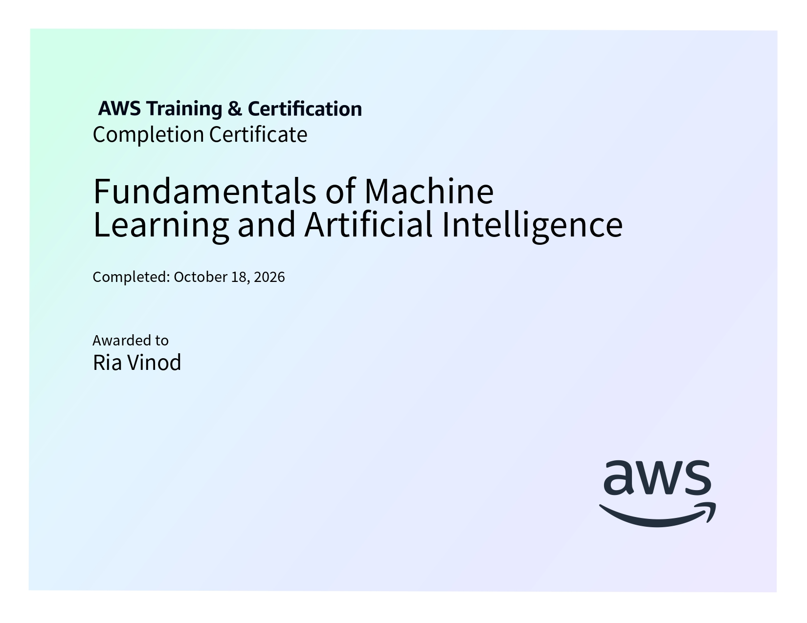

# Fundamentals of Machine Learning and Artificial Intelligence

**AWS AI Practitioner Certification Preparation**

This folder contains structured notes and learning resources for the *Fundamentals of Machine Learning and Artificial Intelligence* course, completed as part of the AWS Artificial Intelligence Practitioner Learning Plan on AWS Skill Builder.

## Certificate of Completion

<p align="center">
  
</p>

## Course Overview

The course introduces the foundational concepts of artificial intelligence, machine learning, deep learning, and generative AI. It also explores AWS services that support AI/ML applications and the cost considerations involved in deploying these solutions.

**Platform:** AWS Skill Builder  
**Learning Plan:** AWS Artificial Intelligence Practitioner Learning Plan  
**Course Level:** Fundamental  
**Duration:** 1 hour

## Topics Covered

### 1. Introduction
- Overview of artificial intelligence and generative AI.
- Relationship between AI, machine learning, deep learning, and generative AI.
- Applications of generative AI in text, image, audio, and code generation.
- Responsible AI considerations, including bias, privacy, and appropriate use.

### 2. Fundamentals of Artificial Intelligence
- Machine learning fundamentals and model development.
- Labeled and unlabeled data.
- Structured and unstructured data.
- Supervised, unsupervised, reinforcement, and semi-supervised learning.
- Model training and inferencing.
- Batch and real-time inferencing.
- Deep learning and artificial neural networks.
- Computer vision and natural language processing.
- Foundation models and their lifecycle.
- Large language models, tokens, embeddings, and vectors.
- Diffusion models, multimodal models, GANs, and VAEs.
- Prompt engineering, fine-tuning, and retrieval-augmented generation (RAG).

### 3. AWS Services
- Amazon SageMaker AI and SageMaker JumpStart.
- Amazon Bedrock and foundation models.
- Amazon Comprehend and Amazon Translate.
- Amazon Textract and Amazon Rekognition.
- Amazon Lex, Amazon Polly, and Amazon Transcribe.
- Amazon Kendra and Amazon Personalize.
- AWS DeepRacer.
- Amazon Q, Amazon Q Developer, and PartyRock.
- AWS AI/ML infrastructure, security considerations, and cost factors.

## Repository Structure

```text
01-Fundamentals-of-ML-and-AI/
├── 01-Introduction.md
├── 02-Fundamentals-of-Artificial-Intelligence.md
├── 03-AWS-Services.md
├── course_1_cert.jpg
└── README.md
```

## Learning Outcomes

After completing this course, I gained an understanding of:

- The core concepts and relationships between AI, ML, deep learning, and generative AI.
- The machine learning model development lifecycle.
- Different learning approaches and generative model architectures.
- Techniques for optimising foundation model outputs.
- AWS services used to develop and integrate AI/ML capabilities.
- Key cost, security, and deployment considerations for AI solutions.

## Learning Resources

- [AWS Artificial Intelligence Practitioner Learning Plan](https://skillbuilder.aws/learning-plan/G8ENMJ5QBE/aws-artificial-intelligence-practitioner-learning-plan/SU2A1EJM1A)
- [Fundamentals of Machine Learning and Artificial Intelligence](https://skillbuilder.aws/learn/16ASDUHF86/fundamentals-of-machine-learning-and-artificial-intelligence/M7JZCTA94N?parentId=SU2A1EJM1A)

---

*Part of my preparation for the AWS Artificial Intelligence Practitioner certification.*
