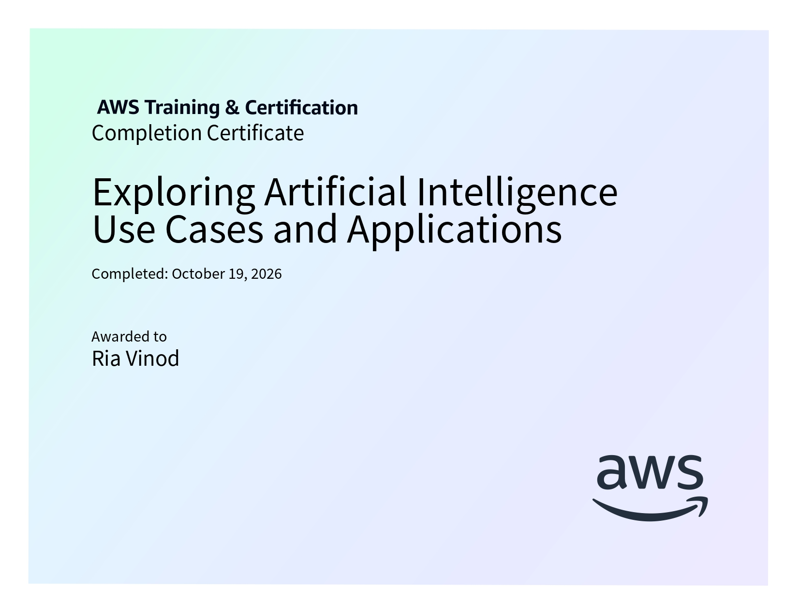

# Exploring Artificial Intelligence Use Cases and Applications

**AWS AI Practitioner Certification Preparation**

This folder contains structured notes and learning resources for the *Exploring Artificial Intelligence Use Cases and Applications* course, completed as part of the AWS Artificial Intelligence Practitioner Learning Plan on AWS Skill Builder.

## Certificate of Completion

<p align="center">
  
</p>

## Course Overview

The course explores real-world applications of artificial intelligence, machine learning, and generative AI across multiple industries. It covers machine learning techniques, generative AI capabilities and challenges, foundation model selection, and business metrics used to evaluate AI solutions.

**Platform:** AWS Skill Builder  
**Learning Plan:** AWS Artificial Intelligence Practitioner Learning Plan  
**Course Level:** Fundamental  
**Duration:** 1 hour

## Topics Covered

### 1. Artificial Intelligence
- Definitions and relationships between AI, machine learning, deep learning, and generative AI.
- Real-world AI use cases across media and entertainment, retail, healthcare, life sciences, financial services, and manufacturing.
- AI applications in computer vision, natural language processing (NLP), intelligent document processing (IDP), and fraud detection.
- Business value of AI applications, including improved customer experience, employee productivity, and business operations.

### 2. Machine Learning
- Fundamentals of machine learning and when AI/ML solutions are appropriate.
- Situations where traditional rule-based programming is more suitable than machine learning.
- Supervised, unsupervised, and reinforcement learning.
- Classification and regression in supervised learning.
- Clustering and dimensionality reduction in unsupervised learning.
- Real-world applications of ML techniques, including fraud detection, customer segmentation, forecasting, and recommendation systems.
- Reinforcement learning through trial and error, rewards, and penalties.

### 3. Generative AI
- Capabilities of generative AI, including adaptability, responsiveness, creativity, personalization, and scalability.
- Challenges such as regulatory violations, social risks, data security and privacy, toxicity, hallucinations, interpretability, and nondeterminism.
- Mitigation strategies for responsible and secure AI deployment.
- Factors to consider when selecting a foundation model, including model type, performance, capabilities, constraints, compliance, and cost.
- Overview of foundation models from AI21 Labs, Amazon, Anthropic, Stability AI, Cohere, and Meta.
- Business metrics for evaluating generative AI applications, including user satisfaction, average revenue per user (ARPU), cross-domain performance, conversion rate, and efficiency.

## Repository Structure

```text
02-Exploring-AI-Use-Cases/
├── 01-Artificial-Intelligence.md
├── 02-Machine-Learning.md
├── 03-Generative-AI.md
├── course_2_cert.jpg
└── README.md
```

## Learning Outcomes

After completing this course, I gained an understanding of:

- Real-world applications of AI across industries and their business value.
- The differences between supervised, unsupervised, and reinforcement learning.
- How to select appropriate ML techniques based on a problem's requirements.
- The capabilities, limitations, and risks of generative AI.
- The factors involved in selecting suitable foundation models.
- Business metrics used to evaluate AI application performance and effectiveness.

## Learning Resources

- [AWS Artificial Intelligence Practitioner Learning Plan](https://skillbuilder.aws/learning-plan/G8ENMJ5QBE/aws-artificial-intelligence-practitioner-learning-plan/SU2A1EJM1A)
- [Exploring Artificial Intelligence Use Cases and Applications](https://skillbuilder.aws/)

---

*Part of my preparation for the AWS Artificial Intelligence Practitioner certification.*
