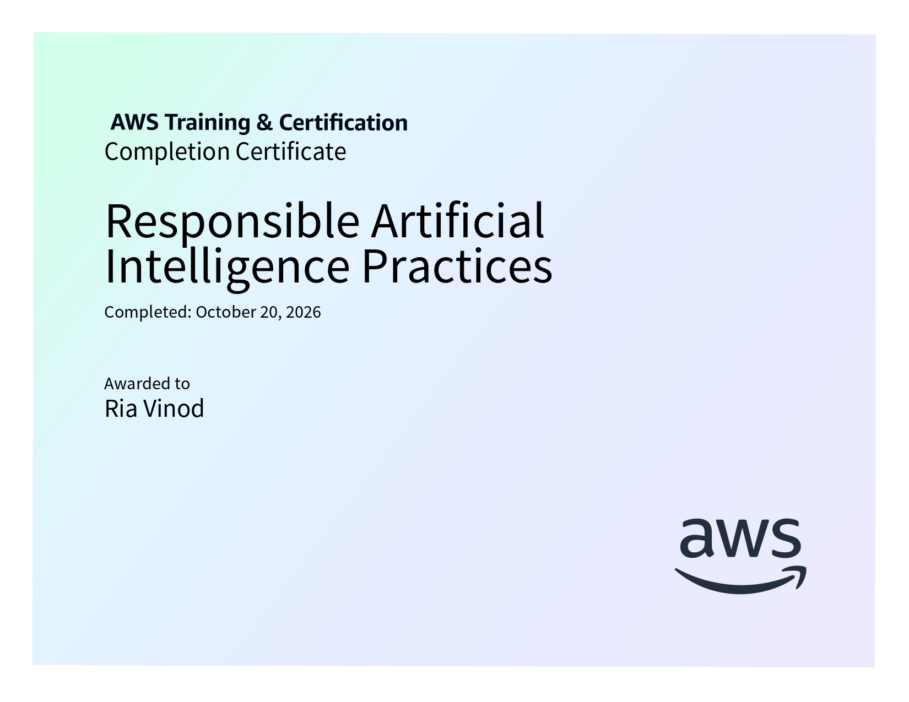

# Responsible AI Practices

**AWS AI Practitioner Certification Preparation**

This folder contains structured notes and learning resources for the *Responsible Artificial Intelligence* course, completed as part of the AWS Artificial Intelligence Practitioner Learning Plan on AWS Skill Builder.

## Certificate of Completion

<p align="center">
  
</p>

## Course Overview

The course explores responsible AI principles and practices for developing, evaluating, and deploying traditional AI and generative AI systems. It covers common AI challenges, the core dimensions of responsible AI, AWS services and tools for implementing responsible AI, responsible model selection, dataset preparation, and the principles of transparent and explainable AI.

**Platform:** AWS Skill Builder  
**Learning Plan:** AWS Artificial Intelligence Practitioner Learning Plan  
**Course:** Responsible AI  
**Focus:** Responsible AI practices, model evaluation, fairness, transparency, explainability, and governance

## Topics Covered

### 1. Introduction to Responsible AI
- Definition and importance of responsible AI.
- Responsible AI throughout the AI lifecycle: design, development, deployment, monitoring, and evaluation.
- Differences between traditional AI and generative AI.
- Business value of generative AI, including creativity, productivity, and connectivity.
- Model accuracy, bias, variance, underfitting, and overfitting.
- Bias–variance trade-off and techniques for improving model generalization.
- Challenges of generative AI, including toxicity, hallucinations, intellectual property, plagiarism, cheating, and disruption of work.
- Core dimensions of responsible AI: fairness, explainability, privacy and security, transparency, veracity and robustness, governance, safety, and controllability.
- Business benefits of responsible AI, including trust, compliance, risk mitigation, and improved decision-making.

### 2. Developing Responsible AI Systems
- Amazon SageMaker AI and Amazon Bedrock.
- Foundation model evaluation using Amazon Bedrock and SageMaker AI Clarify.
- Guardrails for Amazon Bedrock for content filtering, topic restrictions, and PII detection and redaction.
- Bias detection using SageMaker AI Clarify.
- Dataset balancing using SageMaker Data Wrangler, random undersampling, random oversampling, and SMOTE.
- Model prediction explanations and feature importance.
- Model monitoring using Amazon SageMaker Model Monitor.
- Human review workflows using Amazon Augmented AI (Amazon A2I).
- Governance tools: SageMaker Role Manager, SageMaker Model Cards, and SageMaker Model Dashboard.
- AWS AI Service Cards and their role in transparency.
- Responsible model selection based on narrowly defined use cases, performance, customization, model size, inference options, licensing, context windows, and latency.
- Evaluation using representative test datasets and evolving data distributions.
- Sustainability considerations, including energy consumption, resource utilization, and environmental impact.
- Economic considerations and responsible agency, including value alignment, responsible reasoning, autonomy, transparency, and accountability.
- Responsible dataset preparation through inclusive data collection, curation, preprocessing, augmentation, and regular auditing.

### 3. Transparent and Explainable AI Models
- Differences between transparency, explainability, and interpretability.
- Black-box models and the benefits of transparent and explainable models.
- Explainability techniques: SHAP, LIME, counterfactual explanations, and model-agnostic methods.
- Transparent documentation, monitoring, auditing, and human oversight.
- AWS AI Service Cards versus SageMaker Model Cards.
- Model explanation using SageMaker AI Clarify and SageMaker Autopilot.
- Interpretability–performance trade-offs.
- Safety and transparency trade-offs involving accuracy, privacy, security, and output filtering.
- Model controllability and techniques for evaluating and guiding model behavior.
- Human-centered design principles for explainable AI:
  - Design for amplified decision-making.
  - Design for unbiased decision-making.
  - Design for human and AI learning.
- Cognitive apprenticeship, personalization, and user-centered design.
- Reinforcement Learning from Human Feedback (RLHF).
- Amazon SageMaker Ground Truth for human feedback, response ranking, and model optimization.

## Repository Structure

```text
03-Responsible-AI-Practices/
├── 01-Introduction-to-Responsible-AI.md
├── 02-Developing-Responsible-AI-Systems.md
├── 03-Transparent-and-Explainable-AI-Models.md
├── course_3_cert.jpg
└── README.md
```

## Learning Outcomes

After completing this course, I gained an understanding of:

- The importance of responsible AI throughout the AI lifecycle.
- The challenges associated with traditional AI and generative AI.
- Bias, variance, underfitting, overfitting, and model evaluation techniques.
- The core dimensions and business benefits of responsible AI.
- AWS services and tools for model evaluation, bias detection, content safeguards, monitoring, human review, and governance.
- Responsible model selection based on performance, intended use, sustainability, and economic considerations.
- The importance of balanced, diverse, and representative datasets.
- Transparency, explainability, interpretability, and controllability in AI systems.
- Human-centered design principles for explainable AI.
- Reinforcement Learning from Human Feedback (RLHF) and human-in-the-loop workflows.

## Learning Resources

- [AWS Artificial Intelligence Practitioner Learning Plan](https://skillbuilder.aws/learning-plan/G8ENMJ5QBE/aws-artificial-intelligence-practitioner-learning-plan/SU2A1EJM1A)
- [AWS Skill Builder](https://skillbuilder.aws/)

---

*Part of my preparation for the AWS Artificial Intelligence Practitioner certification.*
