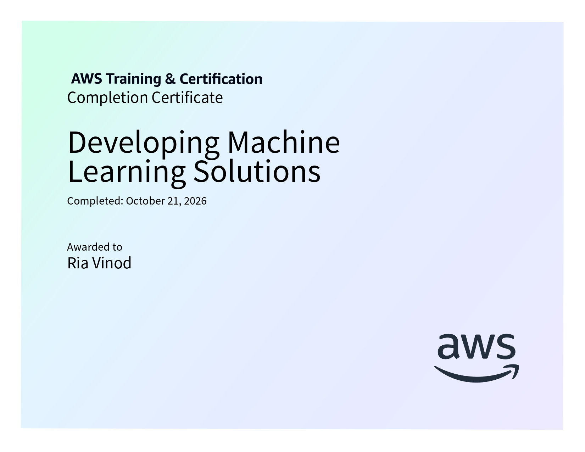

# Developing Machine Learning Solutions

**AWS AI Practitioner Certification Preparation**

This folder contains structured notes and learning resources for the *Developing Machine Learning Solutions* course, completed as part of the AWS Artificial Intelligence Practitioner Learning Plan on AWS Skill Builder.

## Certificate of Completion

<p align="center">
  
</p>

## Course Overview

The course covers the machine learning development lifecycle, tools for developing ML solutions using Amazon SageMaker AI, different sources of ML models, model performance evaluation, deployment strategies, and the fundamental concepts of MLOps.

It explains how machine learning models are developed, trained, evaluated, deployed, monitored, and maintained to meet business requirements.

**Platform:** AWS Skill Builder  
**Learning Plan:** AWS Artificial Intelligence Practitioner Learning Plan  
**Course Level:** Not specified in the provided course content  
**Duration:** Not specified in the provided course content

## Topics Covered

### 1. Machine Learning Development Lifecycle

- Overview of the end-to-end ML development lifecycle.
- Business goal identification and Key Performance Indicators (KPIs).
- ML problem framing.
- Data collection and integration.
- Data preprocessing and visualization.
- Feature engineering.
- Model training, tuning, and evaluation.
- Model deployment, monitoring, retraining, and iteration.
- Amazon call center use case for ML-based customer service routing.

### 2. Developing ML Solutions with Amazon SageMaker AI

- Amazon SageMaker AI and its role in the ML lifecycle.
- Amazon SageMaker Data Wrangler and SageMaker Processing.
- Amazon SageMaker Feature Store.
- Model training and evaluation using SageMaker AI.
- Amazon SageMaker Canvas and SageMaker JumpStart.
- Amazon SageMaker Experiments and Automatic Model Tuning.
- Training, validation, and testing datasets.
- Model fit, overfitting, underfitting, bias, and variance.
- Classification metrics: accuracy, precision, recall, F1 score, and AUC-ROC.
- Regression metrics: mean squared error (MSE) and R-squared.
- Business metrics, cost functions, A/B testing, and canary deployments.

### 3. Sources of ML Models

- Pretrained models and their applications.
- Built-in algorithms available in SageMaker AI.
- Custom model development using ML frameworks.
- Custom Docker images for specialized requirements.
- Supervised and unsupervised learning algorithms.
- Image processing and text analysis algorithms.
- Amazon SageMaker JumpStart for deploying, fine-tuning, and evaluating pretrained models.

### 4. Machine Learning Models Performance Evaluation

- Training, validation, and test datasets.
- Overfitting, underfitting, and balanced models.
- Bias and variance.
- Confusion matrices and classification metrics.
- Accuracy, precision, recall, F1 score, and AUC-ROC.
- Regression evaluation using MSE and R-squared.
- Business KPIs and custom cost functions.
- A/B testing and canary deployments for comparing model variants.

### 5. Model Deployment

- Model deployment and production environments.
- Self-hosted APIs and managed APIs.
- Amazon SageMaker AI model hosting.
- Real-time inference.
- Batch transform.
- Asynchronous inference.
- Serverless inference.
- Deployment choices based on latency, workload requirements, infrastructure, and cost.

### 6. Fundamental Concepts of MLOps

- Introduction to MLOps and its relationship with DevOps.
- Goals and benefits of MLOps.
- Productivity, reliability, repeatability, auditability, and model quality.
- Version control and automation.
- Continuous integration and continuous delivery (CI/CD).
- Continuous training and continuous monitoring.
- Model governance and responsible ML practices.
- Management of code, data, and models throughout the ML lifecycle.
- Model-building, evaluation, registration, approval, and deployment pipelines.
- AWS services supporting MLOps workflows, including SageMaker Feature Store, Experiments, Processing, Model Registry, and Model Monitor.

## Repository Structure

```text
04-Developing-ML-Solutions/
├── 01-Machine-Learning-Development-Lifecycle.md
├── 02-Developing-ML-Solutions-with-Amazon-SageMaker-AI.md
├── 03-Sources-of-ML-Models.md
├── 04-Machine-Learning-Models-Performance-Evaluation.md
├── 05-Model-Deployment.md
├── 06-Fundamental-Concepts-of-MLOps.md
├── course_4_cert.jpg
└── README.md
```

## Learning Outcomes

After completing this course, I gained an understanding of:

- The stages involved in developing and maintaining machine learning models.
- How business requirements are translated into ML problems.
- The importance of data preprocessing, feature engineering, and model evaluation.
- Amazon SageMaker AI tools used to build, train, evaluate, deploy, and monitor models.
- Different sources of ML models and their use cases.
- Classification and regression evaluation metrics and their business applications.
- Different model deployment methods and inference options.
- MLOps principles, including automation, version control, CI/CD, and model governance.
- AWS services used to manage and monitor machine learning workflows.

## Learning Resources

- [AWS Artificial Intelligence Practitioner Learning Plan](https://skillbuilder.aws/learning-plan/G8ENMJ5QBE/aws-artificial-intelligence-practitioner-learning-plan/SU2A1EJM1A)
- [AWS Skill Builder](https://skillbuilder.aws/)

---

*Part of my preparation for the AWS Artificial Intelligence Practitioner certification.*
