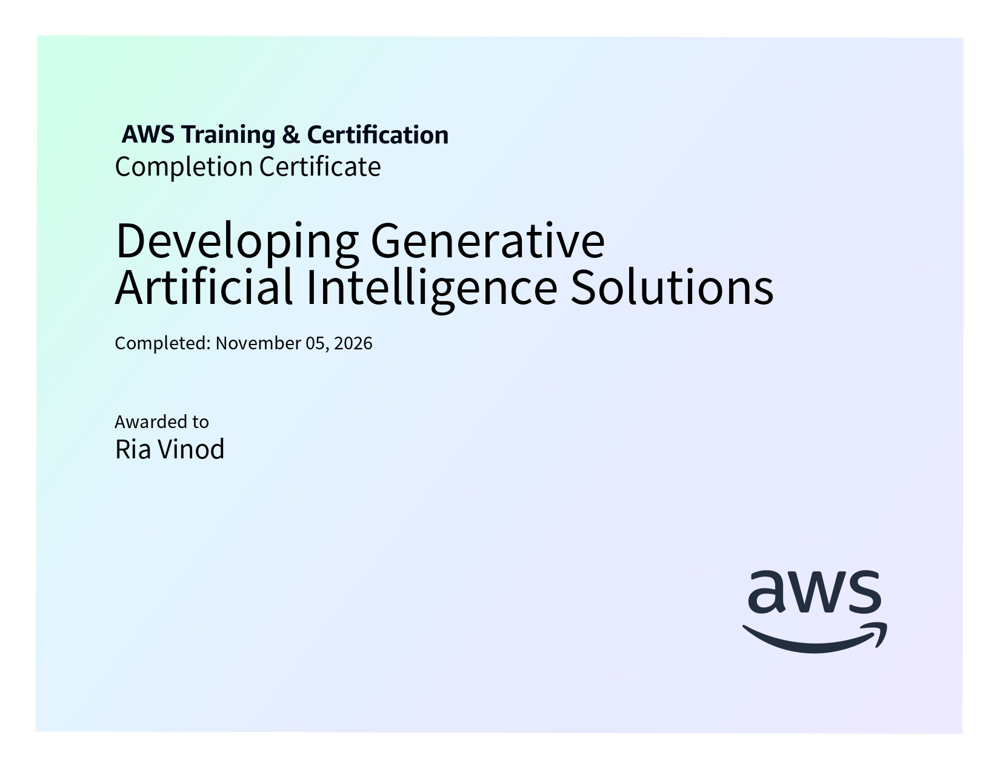

# Developing Generative AI Solutions

**AWS AI Practitioner Certification Preparation**

This folder contains structured notes and learning resources for the *Developing Generative AI Solutions* course, completed as part of the AWS Artificial Intelligence Practitioner Learning Plan on AWS Skill Builder.

## Certificate of Completion

<p align="center">
  
</p>

## Course Overview

This course explores the Generative AI application lifecycle, covering the process of defining business use cases, selecting foundation models, improving model performance, evaluating results, and deploying generative AI applications.

It also introduces important concepts such as prompt engineering, Retrieval Augmented Generation (RAG), fine-tuning, and AI agents.

**Platform:** AWS Skill Builder  
**Learning Plan:** AWS Artificial Intelligence Practitioner Learning Plan  
**Course:** Developing Generative AI Solutions

## Topics Covered

### 1. Introduction

- Overview of Generative AI.
- Generative AI capabilities and challenges.
- Generative AI application lifecycle.
- Stages of the application lifecycle.

### 2. Defining the Use Case

- Introduction to business use cases.
- Parts of a business use case.
- Functional and nonfunctional requirements.
- Key business metrics.
- Approaches to solving business problems using Generative AI.
- Process automation, augmented decision-making, and personalization.

### 3. Selecting a Foundation Model

- Introduction to Foundation Models (FMs).
- Pretrained model selection criteria.
- Cost, modality, latency, and multilingual support.
- Model size and complexity.
- Customization and input/output length.
- Responsible AI considerations.
- Foundation models available on Amazon Bedrock.
- AI21 Labs, Amazon Titan, Anthropic Claude, Cohere, Meta Llama, Mistral AI, and Stability AI.

### 4. Improving Foundation Model Performance

- Introduction to prompt engineering.
- Prompt engineering techniques.
- Zero-shot, few-shot, and chain-of-thought prompting.
- Retrieval Augmented Generation (RAG).
- RAG components and business applications.
- Amazon Bedrock Knowledge Bases.
- Fine-tuning and its types.
- Reinforcement Learning from Human Feedback (RLHF).
- Creating foundation models from scratch.
- Cost trade-offs of model customization.
- Automated multi-step tasks using AI agents.

### 5. Evaluating Foundation Model Results

- Foundation model performance evaluation.
- Human evaluation.
- Benchmark datasets.
- Automated evaluation metrics.
- GLUE, SuperGLUE, SQuAD, and WMT.
- ROUGE, BLEU, and BERTScore.
- Combining evaluation methods for better assessment.

### 6. Deployment

- Introduction to Generative AI application deployment.
- Production environment integration.
- Deployment considerations.
- Cost and AWS Regions.
- Service quotas.
- Security and shared responsibility model.

## Repository Structure

```text
05-Developing-Generative-AI-Solutions/
│
├── 01-Introduction.md
├── 02-Defining-the-Use-Case.md
├── 03-Selecting-a-Foundation-Model.md
├── 04-Improving-Foundation-Model-Performance.md
├── 05-Evaluating-Foundation-Model-Results.md
├── 06-Deployment.md
├── course_5_cert.jpg
└── README.md
```

## Learning Outcomes

After completing this course, I gained an understanding of:

- The different stages of the Generative AI application lifecycle.
- How to identify business problems and define suitable use cases.
- Criteria for selecting appropriate pretrained foundation models.
- Prompt engineering techniques for improving model outputs.
- RAG and its applications in knowledge retrieval and question answering.
- Fine-tuning approaches and their cost implications.
- The role of agents in automating multistep tasks.
- Different methods and metrics for evaluating foundation models.
- Important considerations when deploying Generative AI applications.

## Learning Resources

- [AWS Artificial Intelligence Practitioner Learning Plan](https://skillbuilder.aws/learning-plan/G8ENMJ5QBE/aws-artificial-intelligence-practitioner-learning-plan/SU2A1EJM1A)
- [AWS Skill Builder](https://skillbuilder.aws/)
- [Amazon Bedrock](https://aws.amazon.com/bedrock/)

---

*Part of my preparation for the AWS Artificial Intelligence Practitioner certification.*
